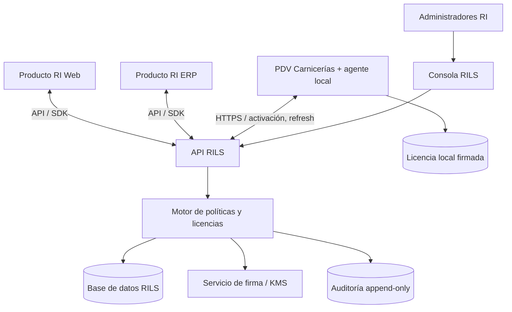

# RILS — Arquitectura integral del sistema corporativo de licenciamiento

**Versión:** 1.0 (especificación inicial)  
**Fecha:** 2026-10-09  
**Propietario funcional:** Recursos Informáticos (RI)  
**Estado:** arquitectura objetivo; requiere validación técnica antes de producción.

## 1. Propósito y alcance

RILS (RI License Server) es una **plataforma corporativa independiente, multiproducto y multicliente** para emitir, activar, administrar, evaluar y auditar derechos de uso de los productos desarrollados por RI. El PDV Carnicerías será el primer consumidor, no el dueño ni el anfitrión de RILS.

**Principio rector:** implementar todas las capacidades de licenciamiento como mecanismos técnicos genéricos y hacer configurables las políticas comerciales. No definir planes comerciales ahora ni escribir comparaciones de nombres de planes en los clientes.

### Alcances
- Productos y versiones; catálogo versionado de funcionalidades, capacidades, límites y unidades.
- Clientes/organizaciones, jerarquías opcionales de sedes/sucursales y sujetos de licencia.
- Contratos de derechos (*entitlements*), licencias, activaciones, instalaciones y dispositivos.
- Políticas de vigencia, período de gracia, conectividad, cuotas, concurrencia y comportamiento de restricción.
- Activación online y asistida/offline; renovación, reemisión, recuperación y revocación.
- Consola administrativa, API pública versionada, agentes/SDK y auditoría.
- Operación multientorno: desktop Windows, servidores, aplicaciones web y futuros dispositivos.

### Exclusiones
- Facturación/cobranza, gestión de suscripciones de terceros, catálogo de precios y decisiones comerciales concretas.
- Funcionalidades internas del PDV, fiscalidad, medios de pago y hardware de carnicerías.
- DRM invulnerable: la defensa cliente es disuasiva, no absoluta.

## 2. Fronteras del sistema



RILS nunca debe importar clases ni tablas de Carnicerías; Carnicerías nunca debe emitir licencias ni conservar claves privadas de firma. El SDK/contrato es el único punto compartido.

## 3. Contextos de dominio

1. **Identidad y tenencia:** organización RI, operadores administrativos, clientes aislados y roles.
2. **Catálogo multiproducto:** `Product`, `ProductVersion`, `FeatureDefinition`, `LimitDefinition`, `PolicySchemaVersion`.
3. **Derechos:** `Entitlement`, `EntitlementGrant`, `PolicySet`, `PolicyOverride`, `License`, `LicenseRevision`.
4. **Instalaciones:** `Installation`, `Activation`, `DeviceIdentity`, `ActivationTransfer`, `SeatLease`.
5. **Ciclo de vida:** `ActivationChallenge`, `Renewal`, `Revocation`, `RevocationList`, `OfflineRequest`.
6. **Consumo:** `UsageEvent`, `UsageCounter`, `QuotaPeriod`, `UsageReconciliation`, `IdempotencyRecord`.
7. **Seguridad y auditoría:** `SigningKeyMetadata`, `AuditEvent`, `SecurityIncident`, `OperatorRole`.

Un cliente puede usar múltiples productos. Cada producto define su propio catálogo mediante registro/versionado. Una licencia puede conceder derechos de uno o varios productos solo si el modelo de concesión lo autoriza explícitamente. Nunca inferir acceso a otro producto por compartir cliente.

## 4. Modelo de políticas genérico

### Dimensiones disponibles
- **Modalidad:** trial, suscripción, perpetua, temporal, cortesía, evaluación, NFR y modalidades ampliables por catálogo.
- **Objeto del derecho:** organización, producto, versión, sucursal, instalación, dispositivo, terminal, usuario, sesión, servicio.
- **Capacidad:** bandera booleana, valor numérico, conjunto de opciones o configuración tipada.
- **Límite:** cardinalidad absoluta, concurrencia, cuota periódica, consumo acumulado, tasa/ventana temporal.
- **Vigencia:** inicio, fin, renovación, prórroga, restricción por versión, mantenimiento.
- **Conectividad:** validación online, refresh deseado, máximo offline, grace, revalidación forzada.
- **Respuesta a fallos:** permitir, advertir, limitar función, modo lectura, operación de contingencia, denegar; por capacidad y severidad.
- **Movilidad:** número de activaciones, transferencias, recuperación, tolerancia ante cambios de hardware.

### Evaluación y precedencia
La evaluación es determinista y versionada:

1. Verificar integridad, producto, audiencia, firma, vigencia del token y bloqueo local conocido.
2. Resolver concesiones explícitas válidas para producto/cliente/instalación.
3. Aplicar restricciones globales de seguridad que no pueden debilitarse con overrides.
4. Combinar políticas por alcance: global → producto → cliente → contrato/licencia → sucursal → instalación, **solo para parámetros declarados heredables**.
5. En conflictos, **denegación explícita prevalece**; límites se intersectan (mínimo efectivo) salvo regla de agregación declarada y auditada; ampliaciones requieren grants independientes y comprobables.
6. Devolver `decision`, `reasonCode`, `effectivePolicyVersion`, `validUntil` y `remaining` cuando proceda.

Los límites `null` indican ilimitado **solamente si el esquema del parámetro lo admite**. Valores ausentes no implican derechos. Feature desconocida = denegar por defecto.

### Diferenciar tres vistas
- **Derecho concedido:** lo asignado administrativamente a un cliente.
- **Derecho efectivo:** el resultado resuelto para un sujeto/instalación en este instante.
- **Uso registrado:** eventos y contadores observados; pueden ser aproximados durante operación offline.

## 5. Licencia criptográfica y confianza

- Separar **credencial de activación** (utilizada para autenticación/provisión) de **documento firmado de derechos** (validable localmente).
- Representar licencia/lease como objeto con esquema y serialización canónica o token firmado estandarizado (preferencia: JWS con EdDSA/Ed25519, si bibliotecas y política criptográfica lo permiten). Incluir `kid` y versión.
- Firma **asimétrica**: clave privada exclusivamente en infraestructura de RI, idealmente KMS/HSM; claves públicas embebidas/distribuidas de forma autenticada en productos.
- Firmar identificadores `licenseId`, `revision`, `productId`, `customerId`, `installationId` cuando aplique, `issuedAt`, `notBefore`, `expiresAt`, `offlineUntil`, grants, políticas y `schemaVersion`.
- **Nunca** incluir secretos o datos personales innecesarios en licencia local, que puede ser inspeccionada.
- Rotación de claves y período de coexistencia; revocación mediante sincronización y documentos con vencimiento finito.
- Licencia firmada **no equivale** a autorización perpetua incondicional: disponibilidad offline y efecto de revocación tienen límites explicitados en cada política.
- Proteger almacenamiento local mediante APIs del sistema operativo cuando sea útil, sin tratarlo como sustituto de la firma.
- Evitar dar al renderer Angular acceso a secretos, endpoints administrativos o control exclusivo de validaciones.

### Amenazas y límites
Modelar: edición de token, patching del cliente, clonación de VM/disco, spoofing de hardware, reloj atrasado, restore de snapshot, replay de cuotas, extracción de archivos, fuerza bruta de activación, robo de credenciales y compromiso del servidor. Mitigaciones: firma, fingerprint tolerante y privacy-conscious, secuencias monotónicas/counters cuando exista soporte, detección de retroceso de reloj, leases cortos para cambios críticos, rate limiting, idempotencia, auditoría y protecciones anti-replay. **No prometer** detección perfecta de manipulación de fecha o clones totalmente offline.

## 6. Funcionamiento offline, continuidad y consistencia

- El cliente mantiene licencia firmada y último estado validado; valida localmente sin llamar por cada venta.
- Diferenciar expiración de la suscripción, expiración del documento firmado, fin de ventana offline y fin de gracia: **cuatro fechas distintas**.
- Desconexión ≠ licencia vencida. Política separada por causa.
- La caducidad del token o pérdida de conectividad no debe ocasionar pérdida de datos ni bloqueo abrupto de operación fiscal/ventas en curso. Definir una política explícita de contingencia para operaciones esenciales; sin prometer derechos ilimitados.
- **Cuotas offline:** registrar eventos locales durables con IDs únicos; aplicar límites locales conservadores y reconciliar al reconectar. Reconocer que el límite global exacto entre múltiples equipos offline no puede garantizarse sin coordinación.
- **Concurrencia:** leases online con TTL/heartbeat para límite exacto; offline sólo admite reservas/preasignación de cupos o un compromiso de consistencia, a elegir mediante política.
- Revisar la política de cada producto respecto de qué operaciones no deben interrumpirse por razones de seguridad operacional o normativa.

## 7. API pública (versión /v1)

Separar API administrativa de API de producto/instalación. Nombres conceptuales:

| Grupo | Operaciones |
|---|---|
| Catálogo | `POST /v1/admin/products`, `PUT /v1/admin/products/{id}/catalog`, `GET /v1/catalog/{productId}` |
| Clientes | `POST /v1/admin/customers`, `GET /v1/admin/customers/{id}` |
| Derechos | `POST /v1/admin/entitlements`, `POST /v1/admin/licenses`, `POST /v1/admin/licenses/{id}/revisions` |
| Activaciones | `POST /v1/activations/challenge`, `POST /v1/activations`, `POST /v1/activations/renew`, `POST /v1/activations/deactivate` |
| Offline | `POST /v1/admin/offline-activations/issue`, importación verificada de solicitud firmada/código de desafío |
| Estado | `GET /v1/installations/{id}/status`, `GET /v1/public/keys` (o JWKS autenticado por TLS) |
| Uso | `POST /v1/usage/events` (idempotente), `GET /v1/admin/usage` |
| Revocación | `POST /v1/admin/licenses/{id}/revoke`, `GET /v1/revocations` |
| Auditoría | `GET /v1/admin/audit-events` |

Es una **propuesta de contrato**, no un API ya construido. OpenAPI será la fuente de verdad; publicar códigos de error estables, paginación, `ETag`, trace IDs, límites de tamaño, versionado y `Idempotency-Key` en escrituras reintentables. No confiar en `customerId` o `installationId` informados por el cliente sin autorización de ámbito.

## 8. Identidad, autenticación y autorizaciones

- Consola/admin: OIDC con MFA obligatorio para roles privilegiados, RBAC y verificación de alcance por cliente/producto; separar operadores de soporte, emisores de licencia, auditores y custodios de claves.
- Clientes software: credenciales de activación de un solo uso o flujo desafío/respuesta; después, credenciales de instalación con rotación y capacidades mínimas. No incluir secreto maestro compartido en binarios distribuidos.
- Servicios RI a RILS: OAuth2 client credentials/mTLS según infraestructura, nunca cuenta administrativa reutilizada.
- Defenderse de IDOR/BOLA: validar propiedad de cada ID recibido, no solo autenticación. Registrar cambios privilegiados con actor, antes/después y motivo.
- Secretos en secret manager; TLS, rate limits, límites de solicitudes, logs sin tokens ni PII sensible.

## 9. Persistencia e infraestructura

**Recomendación inicial no vinculante:** backend ASP.NET Core LTS seleccionado al iniciar, PostgreSQL, EF Core/migraciones, API REST/OpenAPI, dashboard web separado y workers de reconciliación. Elegir stack final con responsable de infraestructura; no derivarlo de Carnicerías.

- Base transaccional con transacciones e índices por `tenantId`, `productId`, `licenseId`, `installationId`.
- Auditoría append-only separada lógicamente de tablas operativas; retención y exportación configurable.
- Cola/outbox para eventos importantes (`LicenseIssued`, `LicenseRevoked`, `ActivationCreated`).
- Backups, restauración probada, migraciones hacia adelante y política de retención de datos.
- Configuración por entorno; test/staging/prod aislados con claves y datos separados.
- Observabilidad: métricas de activación, rechazos, latencia, firma, vigencias, reconciliaciones, trazas correlacionadas.
- Despliegue replicable por contenedores; escalado API stateless y DB durable; firma encapsulada.

## 10. Contrato para productos consumidores

Un SDK/agente oficial independiente del producto expondrá como mínimo:

```text
initialize(productId, productVersion, installationContext)
activate(activationMaterial)
refresh()
getLicenseState()
can(featureKey, context?) -> Decision
checkLimit(limitKey, amount?, context?) -> Decision
recordUsage(event) -> LocalDurableReceipt
getDiagnostics() -> RedactedDiagnostics
```

El cliente nunca decide permisos por nombre de plan. El SDK implementa validación de firma, caché segura, máquina de estados, eventos, serialización y compatibilidad de esquema. Cada producto decide cómo aplicar una denegación a su funcionalidad concreta. No usar `can()` como control de seguridad del servidor del producto: allí también se deben verificar permisos propios.

## 11. Máquina de estados de licencia/instalación

Estados operativos sugeridos: `UNACTIVATED`, `ACTIVE`, `OFFLINE_VALID`, `GRACE`, `RESTRICTED`, `EXPIRED`, `SUSPENDED`, `REVOKED`, `INTEGRITY_ERROR`, `RECOVERY_REQUIRED`. Modelar licencia comercial, lease firmado y activación como máquinas de estado distintas; evita contradicciones. Cada transición especificará disparador, evidencia, impacto y audit trail.

## 12. Casuística mínima a probar

- Cliente con 2 productos y políticas distintas; sucursales y terminales múltiples.
- Plan de prueba, permanente, suscripción y ampliación de funcionalidades sin desplegar nuevamente.
- Cambio de hora, reemplazo de disco/placa, reinstalación y transferencia autorizada.
- Conexión intermitente, 30 días offline configurados, revocación no conocida hasta próximo contacto.
- Múltiples equipos que consumen cuota offline; reconciliación de duplicados y excesos.
- Carrera por última activación, lease concurrente caducado, heartbeat perdido.
- Rotación de claves; licencia emitida con clave antigua; esquema nuevo frente a SDK viejo.
- Robo de token, replay de activación, fuga de datos entre tenants, operador sin permiso.
- Venta iniciada durante validez que finaliza después de un vencimiento, sin perder datos.

## 13. Decisiones que quedan abiertas (configurables o validables)

- Stack e infraestructura definitiva del servidor y de su consola.
- Catálogo de políticas inicial y reglas de agregación por cada tipo de límite.
- Política de contingencia de operaciones esenciales por producto.
- Nivel exacto de dureza anti-clonado/anti-rollback tolerable por plataforma.
- Reserva offline de cupos vs concurrencia online estricta.
- Cadencia predeterminada de refresh, períodos offline y gracia: **sin valores comerciales fijos**.
- Gobernanza y publicación de nuevas definiciones de capacidades de productos.

## 14. Condiciones de aceptación de arquitectura

1. Registrar un segundo producto de RI sin cambiar el núcleo RILS.
2. Cambiar la política de una licencia sin publicar una versión del producto consumidor.
3. Activar una terminal por API y otra offline asistida, con documento firmado verificable.
4. Desconectar el servidor y seguir evaluando licencias offline bajo límites explícitos.
5. Revocar en RILS y propagar en el siguiente contacto; documentar latencia máxima offline.
6. Aislar datos y autorizaciones por cliente y producto, con tests automatizados.
7. Auditar emisión, cambios, activación, transferencia, revocación y accesos administrativos.
8. Recuperar una instalación sin reutilizar secretos administrativos.

## 15. Referencias de diseño

- OWASP API Security Top 10 (2023): https://owasp.org/API-Security/
- RFC 7515 (JWS): https://www.rfc-editor.org/rfc/rfc7515
- RFC 8037 (OKP / EdDSA para JOSE): https://www.rfc-editor.org/rfc/rfc8037
- RFC 8725 (JWT Best Current Practices): https://www.rfc-editor.org/rfc/rfc8725

**La presente arquitectura es la autoridad para los documentos `02_RILS_PROMPT_CODEX_SERVIDOR.md` y `03_PDV_CARNICERIAS_INTEGRACION_RILS.md`.**
