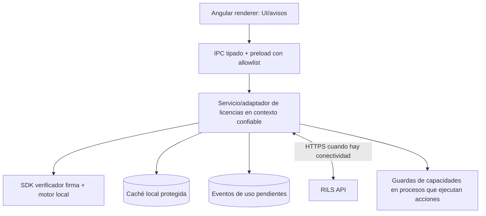

# Instrucciones para Codex — Integrar PDV Carnicerías como cliente de RILS

**Proyecto existente:** PDV Carnicerías (Electron + Angular, Windows)  
**Versión:** 1.0  
**Documentos obligatorios:** `01_RILS_ARQUITECTURA_INTEGRAL.md` y contrato publicado por RILS (`openapi/rils-v1.yaml` + licencia JSON Schema).  
**Regla innegociable:** El PDV **es consumidor** de RILS; no implementar servidor, consola ni autoridad de emisión dentro de Carnicerías.

## Objetivo

Preparar e integrar la aplicación PDV para utilizar licencias y políticas emitidas por RILS. La solución debe operar localmente bajo políticas firmadas, tolerar cortes de conectividad según derechos vigentes, evitar detener ventas en curso de manera brusca y mantener **todas las decisiones comerciales fuera del código**.

## Antes de modificar código

1. Auditar la arquitectura actual Electron/Angular, procesos main/preload/renderer, backend local si existe, persistencia, empaquetado, mecanismo de actualización y arranque.
2. Localizar puntos de entrada a funciones licenciables: facturación, integraciones de pago, balanzas, impresoras, stock, caja, sucursales, usuarios y APIs.
3. Identificar repositorio y ramas; preservar convenciones existentes. Producir `docs/rils/INTEGRATION_ASSESSMENT.md` con hallazgos.
4. **No reestructurar la arquitectura actual** ni decidir nuevos servicios, frameworks, bases de datos o patrones sin consultarme. Trabajar con adaptadores sobre la arquitectura actual.
5. Si RILS todavía no está implementado, crear interfaces y mocks verificables, **sin inventar endpoints reales**. La integración HTTP debe basarse exclusivamente en OpenAPI aprobado; bloquear la implementación remota donde el contrato esté pendiente.

## Fronteras de responsabilidad

| RILS | PDV Carnicerías |
|---|---|
| Registrar catálogo del producto | Declarar las capacidades que consume, para registro/versionado en RILS |
| Emitir y firmar licencias | Solicitar activación y guardar documento firmado |
| Administrar clientes y políticas | Consultar derechos efectivos por SDK/adaptador |
| Autorizar activaciones/transferencias | Identificar instalación; iniciar recuperación/transferencia asistida |
| Administrar revocaciones | Sincronizar estado según política; informar al usuario |
| Reconciliar cuotas globales | Registrar consumos locales idempotentes |
| Gestionar firma privada | Verificar firma con claves públicas confiables |

## Diseño de integración



El renderer no debe controlar permisos exclusivamente ni tener claves privadas. Restringir IPC (canales validados, tipo/forma de payload, origen permitido) y exponer solo operaciones necesarias. Si una acción está en backend local, validar capacidad en ese mismo punto de ejecución además de reflejarla en la UI. El PDV puede mostrar/ocultar funcionalidad por UX, pero la verificación efectiva debe residir en la capa que ejecuta la operación.

## Identificación del producto e instalación

- Identificador estable sugerido: `ri.pdv.carnicerias` (registrar en RILS; cambiar solo con aprobación).
- `productVersion` y `licenseSchemaVersion` separados.
- Crear `installationId` UUID persistente en la primera instalación; evitar depender únicamente de MAC, número de disco o usuario Windows.
- Capturar señales de equipo mínimas y con enfoque de privacidad, para detectar migraciones y clonado según política; nunca subir inventarios completos de hardware sin justificación.
- Permitir recuperación, reinstalación y cambio de PC por flujo autorizado, evitando consumir una segunda activación indefinidamente.

## Catálogo inicial de capacidades (BORRADOR; validar con código real)

Estas son **keys técnicas**, no nombres de planes ni promesas de funciones existentes:

```yaml
productId: ri.pdv.carnicerias
catalogVersion: 1
features:
  - pdv.sales.checkout
  - pdv.fiscal.electronic_invoicing
  - pdv.fiscal.fiscal_printer
  - pdv.payments.mercadopago
  - pdv.payments.integrated_terminal
  - pdv.scales.automatic_weight
  - pdv.inventory.management
  - pdv.reports.analytics
  - pdv.multi_branch
limits:
  - key: pdv.terminals.activated
    type: count
  - key: pdv.terminals.concurrent
    type: concurrent
  - key: pdv.documents.monthly
    type: quota
    period: calendar_month
  - key: pdv.sales.monthly
    type: quota
    period: calendar_month
```

No implementar módulos inexistentes. Realizar mapeo real `capabilityKey → operación/feature` en archivo separado `docs/rils/CAPABILITY_MAPPING.md`. Mantener claves estables, namespace y versionado; no usar `if (plan === 'premium')`.

## Contrato de adaptador local requerido

```typescript
export type LicenseDecision = {
  allowed: boolean;
  reasonCode: string;
  effectiveUntil?: string;
  remaining?: number | null;
  policyRevision?: string;
};

export interface ILicenseClient {
  initialize(): Promise<void>;
  getState(): Promise<LicenseState>;
  activate(input: ActivationInput): Promise<ActivationResult>;
  refresh(): Promise<RefreshResult>;
  can(featureKey: string, context?: Record<string, unknown>): Promise<LicenseDecision>;
  checkLimit(limitKey: string, quantity?: number): Promise<LicenseDecision>;
  recordUsage(event: LicenseUsageEvent): Promise<void>;
  getDiagnostics(): Promise<RedactedLicenseDiagnostics>;
}
```

Los tipos `LicenseState`, `ActivationInput`, etc. deben alinearse a OpenAPI/SDK final, no inventar contratos incompatibles. El adaptador oculta HTTP, firma, almacenamiento, errores y reintentos a los consumidores de negocio. Evitar tráfico de licenciamiento por cada operación normal de caja.

## Activación y soporte

- Primera ejecución: comprobar estado; si no hay licencia, ofrecer activación online o archivo/código de activación offline asistida.
- Registrar activación con material de un solo uso/challenge según contrato; no incluir secreto de RI dentro del instalador.
- Pantalla de estado legible: producto, licencia parcial/masked, instalación, próximas verificaciones, último refresh, vigencia y estado; opción de reintentar y exportar diagnóstico **sin tokens**.
- Transferencia o reparación autorizada si cambia el hardware, con mensajes no técnicos para operador de caja.
- Mantener entorno de homologación separado de producción y claves públicas por ambiente.

## Estado local y políticas de contingencia

Implementar estados separados: `UNACTIVATED`, `ACTIVE`, `OFFLINE_VALID`, `GRACE`, `RESTRICTED`, `EXPIRED`, `SUSPENDED`, `REVOKED`, `INTEGRITY_ERROR`, `RECOVERY_REQUIRED`. Respetar el resultado del SDK sin inventar plazos de grace/offline.

- Guardar documento firmado en caché durable de ubicación definida por arquitectura actual; verificar integridad en cada carga relevante.
- Refresh asíncrono con retry/backoff y jitter; nunca bloquear la interfaz esperando llamada HTTP de licenciamiento.
- Diferenciar falta de Internet, error de servidor, licencia vencida y token adulterado. Nunca convertir fallo HTTP en licencia ilimitada.
- Frente a vencimientos/restricciones, aplicar conducta **según política por capacidad**. Para ventas iniciadas y comprobantes fiscales pendientes, preservar integridad y ofrecer cierre/contingencia aprobados; no eliminar transacciones ni cortar flujo a mitad de emisión.
- Cambio de reloj o rollback: detectar mejor esfuerzo, registrar incidente y aplicar política; no afirmar defensa perfecta offline.
- La verificación offline tiene la limitación de no conocer una revocación hasta renovar/sincronizar.

## Cuotas y concurrencia

- `recordUsage` genera `eventId` UUID, `occurredAt`, `productId`, `installationId`, `metricKey`, `quantity`, sin PII salvo obligación justificada.
- Encolar durablemente y sincronizar por lotes con idempotencia, guardando ACK; evitar duplicaciones ante reintentos/cortes.
- Los límites mensuales globales y terminales concurrentes estrictos requieren coordinación: respetar leases/reservas o comportamientos degradados definidos por RILS. **No prometer** exactitud global con varios equipos desconectados.
- No basar facturación fiscal ni stock en aceptación inmediata de un evento remoto RILS.

## Seguridad en Electron

1. `contextIsolation: true`, `nodeIntegration: false`; usar preload limitado y validado.
2. No transmitir licencia completa, credenciales o secretos innecesarios al renderer.
3. Verificación de firma y enforcement fuera de Angular renderer, con controles equivalentes en backend local si existe.
4. No aceptar cualquier URL de RILS desde input no confiable; HTTPS y dominios de entorno administrados.
5. No permitir habilitación de features por configuración local sin firma.
6. Logs sanitizados; nunca credenciales de activación, tokens completos, fingerprint detallado o clave privada.
7. Firma de ejecutables y actualizaciones en la estrategia del PDV, separada de firma de licencias.

## Pruebas de integración obligatorias

- Sin licencia → estado no activado, sin fallos no controlados.
- Licencia válida con módulo habilitado/deshabilitado → guardas en UI y ejecución.
- Licencia alterada → rechazo criptográfico.
- Arranque sin Internet con documento firmado vigente y offline permitido → funciona conforme a política.
- Error de red en medio de venta → transacción íntegra, ningún bloqueo abrupto por consulta RILS.
- Transición a GRACE y RESTRICTED en simulación de reloj/tiempo, sin usar tiempo del sistema de forma ingenua.
- Reinstalación/cambio de PC → flujo de recuperación sin fuga de secretos.
- Registro duplicado de consumo y reconexión → sincronización idempotente.
- Llaves de firma rotadas → comportamiento compatible según `kid`.
- Renderer manipulado → una operación protegida ejecutada en contexto confiable se deniega cuando corresponde.

## Plan de implementación — sin alterar arquitectura existente

**Fase 0:** auditoría del PDV y mapeo de capacidades. Entregar lista de impactos y dudas de arquitectura al responsable de RI.

**Fase 1:** interfaces `ILicenseClient`, DTOs tipados, implementación mock, pruebas unitarias, pantallas básicas de estado y activación simulada.

**Fase 2:** adaptador real al SDK/contrato OpenAPI de RILS aprobado, verificación de firma, caché, máquina de estados y homologación.

**Fase 3:** guardas en operaciones, consumos y cuotas durables, recuperación y casos offline.

**Fase 4:** pruebas end-to-end, empaquetado Windows, firma del aplicativo si está disponible, telemetría saneada, manual de soporte.

## Entregables del agente

- `docs/rils/INTEGRATION_ASSESSMENT.md`
- `docs/rils/CAPABILITY_MAPPING.md`
- `docs/rils/INTEGRATION_DECISIONS.md`
- Código de adaptador/cliente aislado y mocks
- Pruebas de contratos/integación y evidencia de ejecución
- Manual de activación, diagnóstico y recuperación
- Lista de incompatibilidades o decisiones que requieran consultar a RI

## Criterios de aceptación

1. El repositorio PDV no contiene servicio emisor ni clave privada de RILS.
2. Ninguna condición de licenciamiento depende del nombre de un plan comercial.
3. El agente puede cambiar su adaptador sin cambiar módulos de negocio.
4. El sistema arranca y continúa trabajando offline cuando un documento firmado y política lo autorizan.
5. El motor de ejecución impide operaciones no permitidas, no sólo oculta botones.
6. La pérdida de RILS no implica borrar datos ni invalidar ventas en curso.
7. Tests automatizados reproducibles y documentación de setup homologación.
8. Cambios de arquitectura se detienen para consulta con el responsable de RI.

## Primer mensaje de ejecución al agente PDV

> Leé `03_PDV_CARNICERIAS_INTEGRACION_RILS.md` y `01_RILS_ARQUITECTURA_INTEGRAL.md`. Esta aplicación será **cliente** del servidor corporativo independiente RILS. Primero auditá la arquitectura existente y documentá los puntos de integración y el catálogo técnico real; no modifiques su arquitectura sin consultarme. Prepará interfaces, mocks, estado de licencia y pruebas. No inventes endpoints: para la integración real esperá al OpenAPI y SDK versionados del proyecto RILS. No implementes un servidor de licencias dentro del PDV.
