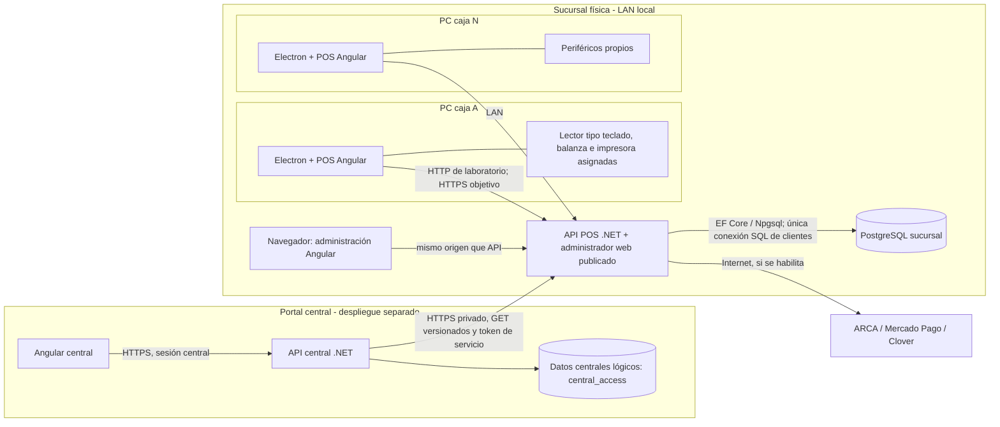

# Arquitectura de la solución Carnicerías — estado actual

**Corte:** 19/10/2026. **Audiencia:** desarrollo, implementación y quien genere diagramas o documentación derivada. **Carácter:** descripción del software existente y de la topología aprobada; no certifica aptitud productiva.

Para metodología, versiones, conexiones, credenciales y fronteras de seguridad, ver el [anexo técnico](anexo-tecnico-metodologia-conectividad-seguridad.md).

## 1. Lectura ejecutiva y reglas para interpretar este documento

Carnicerías es un POS para carnicerías con administración de negocio y configuración, operado por varias cajas de una sucursal. La **sucursal es la unidad operativa autónoma**: su API es la autoridad sobre ventas, turnos, pagos registrados, catálogo aplicable y existencias. Las cajas son clientes Electron y los periféricos están conectados a cada PC de caja. Los administradores locales usan una aplicación web Angular. Existe, además, un **portal central separado** para consultar en vivo información resumida de sucursales; no participa en la confirmación de ventas ni administra remotamente las tablas del POS.

Hay que distinguir siempre dos planos:

1. **Topología objetivo de instalación por sucursal:** un servidor local con API y PostgreSQL por sucursal física, varias cajas Electron y navegadores de administración en su LAN. Es una decisión de arquitectura y hay un paquete de laboratorio, pero el workshop físico multiservidor/multicaja sigue pendiente.
2. **Laboratorio de desarrollo actual:** hay **una única base de datos de aplicación**, `carnicerias_test_visual`, en PostgreSQL Docker del equipo de desarrollo (`127.0.0.1:55433`). En ella conviven datos ficticios de varias empresas/sucursales y el esquema lógico de la central. Se pueden iniciar distintas instancias de API para ensayar alcances, pero **no son bases independientes**. No crear otra base durante este desarrollo sin autorización expresa.

No interpretar una función de homologación, sandbox o laboratorio como una integración fiscal o de pagos lista para producción. No incluir secretos, cadenas de conexión reales, certificados ni tokens en diagramas o documentación generada.

## 2. Contexto, actores y límites

| Actor/sistema | Relación con Carnicerías | Límite de responsabilidad |
| --- | --- | --- |
| Cajero | Inicia sesión en una caja vinculada a la sucursal, abre su turno, arma y cobra tickets. | No elige libremente empresa/sucursal ni opera sin caja habilitada y turno abierto. |
| Administrador local de empresa/sucursal | Usa el administrador web para negocio y configuración: usuarios, cajas, catálogo, precios, stock, clientes, impuestos, integraciones y conexión a central, según permisos. | Sus operaciones están acotadas a la empresa/sucursal y sus permisos; no es administrador de otras empresas. |
| SuperAdmin local del fabricante | Aprovisiona empresas y sus administradores en el entorno POS. | Su identidad no equivale a la del SuperAdmin del portal central. |
| Administrador central de empresa | Conecta sus sucursales autorizadas y consulta indicadores de negocio en el portal central. | No inicia sesión en el POS con la sesión central y no escribe ventas, stock ni caja remota. |
| SuperAdmin central de Recursos Informáticos | Crea empresas y administradores del portal central. | Es una identidad separada de las empresas clientes y del SuperAdmin local. |
| ARCA, Mercado Pago y Clover | Servicios externos opcionales; requieren conectividad y credenciales propias. | No son fuente de verdad de la venta local; cada integración tiene estado y límites distintos. |
| Frigorífico/abastecedor | Origen potencial de piezas trazables y datos de stock. | La carga manual y el perfil de códigos existen; importación masiva/interfaz ERP directa quedan pendientes. |

## 3. Mapa de despliegue objetivo

La flecha central → sucursal **no** significa que la sucursal requiera central para vender. Tampoco representa replicación de tablas ni escritura remota. La instalación real necesita HTTPS/red privada, respaldos y restauración comprobada, ejecución desatendida y validación física de dispositivos; esos controles no se infieren del paquete actual.

**Excepción del laboratorio:** los esquemas `platform_access`, `catalog_pricing`, `customers_credit`, `pos_sales`, `payments_cash`, `inventory` y `central_access` comparten hoy la misma base física `carnicerias_test_visual`. El portal central utiliza su propio `DbContext` y sus tablas `central_access`; no consulta directamente las tablas comerciales del POS. En producción, la ubicación física de los datos centrales queda por decidir: este documento no presupone una base central ya desplegada.

## 4. Inventario de componentes ejecutables y código

| Componente | Tecnología y ubicación | Responsabilidad actual |
| --- | --- | --- |
| API de sucursal/POS | ASP.NET Core .NET 10, `src/Carnicerias.Api` | Expone autenticación, administración, catálogo, tickets, caja, stock, cobros, fiscalidad e integración opcional de consulta central. En un paquete publicado sirve los archivos estáticos del administrador Angular. |
| Dominio | .NET, `src/Carnicerias.Domain` | Reglas y cálculos de negocio compartidos, sin interfaz de usuario. |
| Acceso/infraestructura POS | .NET + EF Core/Npgsql, `src/Carnicerias.PlatformAccess` y `src/Carnicerias.Infrastructure` | Entidades, permisos, persistencia, migraciones e identidad local. `PlatformAccessDbContext` concentra los esquemas POS. |
| Web POS/administración | Angular 22, `src/Carnicerias.Web` | Interfaz de caja `/pos` y administrador local `/admin`, con secciones de negocio y configuración; es una misma aplicación web con rutas y guards. |
| Caja de escritorio | Electron, `src/Carnicerias.Pos` | Carga el Angular empaquetado con `app://bundle`, apunta a la API configurada, mantiene perfil y credencial de terminal, y ejecuta integraciones nativas de balanza, impresora y descarga de PDF. |
| API central | ASP.NET Core .NET 10, `src/Carnicerias.Central.Api` | Sesiones centrales, alta de empresas/administradores centrales, conexiones a sucursales y resumen federado de lectura. Es otro proceso y otra frontera de autenticación. |
| Persistencia/servicios centrales | .NET + EF Core/Npgsql, `src/Carnicerias.Central.Infrastructure` | `CentralAccessDbContext`, migraciones del esquema `central_access`, verificación de destinos y consultas vivas a sucursales. |
| Web central | Angular 22, `src/Carnicerias.Central.Web` | Portal para administrador de empresa y pantalla separada de SuperAdmin central (`/superadmin`). |
| Inicialización y empaquetado | `tools/Carnicerias.Bootstrap`, scripts en `tools/` | Aprovisionamiento, migraciones, publicación y arranque de laboratorio; no forman parte de la ruta de venta en ejecución. |

El navegador del administrador local y Electron consumen la misma API de sucursal, pero Electron agrega identidad de terminal y acceso a hardware. El portal central no reutiliza las sesiones humanas del POS.

## 5. Conexiones y fronteras de confianza (para mapas de componentes)

| Origen → destino | Canal/contrato | Identidad y datos | Comportamiento ante falla |
| --- | --- | --- | --- |
| Electron → API POS | HTTP(S) `/api/*` por LAN; destino por `pos-config.json` | Sesión de cajero + credencial de terminal local protegida; alcance de empresa/sucursal/caja validado por servidor. | Sin API/LAN no hay confirmación offline. Solo se recuperan borradores ya persistidos. |
| Navegador admin → API POS | Mismo origen del sitio publicado, `/api/*` | Sesión y permisos locales. | La administración no accede directamente a PostgreSQL. |
| API POS → PostgreSQL local | Npgsql/EF Core | Cadena configurada fuera de Git; acceso exclusivo del servidor. | No se confirma venta si no se puede persistir la transacción. |
| Electron → COM/descargas locales | IPC a proceso principal de Electron | Solo dispositivos asignados a esa caja: balanza serial, impresora de texto o Hasar de laboratorio; PDF en la PC. | Una falla de impresión posterior no deshace una venta confirmada. Sin dispositivo asignado no se abre COM. |
| Web central → API central | HTTP(S) `/api/v1/*` | Cookie/sesión central, separada de la local. | No afecta operación de sucursal. |
| API central → datos centrales | EF Core, esquema `central_access` | Solo identidades, auditoría, instalaciones, destinos y credenciales cifradas centrales. | No lee tablas POS como atajo para el dashboard. |
| API central → API sucursal | `GET /api/central/v1/installation` y `/summary` | Bearer de servicio específico; tres IDs remotos fijos y verificados, destino/IP aprobados. | Si una sucursal no responde, dashboard incompleto; no se presenta un parcial como total general. |
| API POS → ARCA | Servicios de homologación para comprobantes electrónicos | Certificado/configuración fiscal protegidos del entorno de prueba. | La venta ya registrada no se revierte si la emisión posterior falla; queda para reintento. |
| API POS → Mercado Pago | API de sandbox, QR dinámico/fijo y Point según configuración | Credenciales de pasarela protegidas; intención de pago vinculada al ticket. | El POS verifica aprobación antes de registrar ese cobro; el sondeo mientras la pantalla está abierta no reemplaza una estrategia de webhooks productiva. |
| API POS → Clover | OAuth y consulta/probe de comercio sandbox | Vinculación y tokens de prueba. | Vinculación **no equivale a cobro POS Clover**: falta dispositivo/Dev Kit y flujo de pago validado. |

**Fronteras:** Internet no debe exponer toda la API local; los retornos OAuth/webhooks necesitan ingreso HTTPS acotado a diseñar. La central valida destino exacto e IP permitida por empresa, no sigue redirecciones, y guarda tokens cifrados fuera del navegador; la clave maestra vive fuera de la base y de Git. En una instalación real se exige HTTPS; HTTP LAN o loopback se admite solo mediante opt-in de laboratorio.

## 6. Propiedad de datos y alcance de identidad

| Esquema actual | Propiedad funcional de los datos |
| --- | --- |
| `platform_access` | Empresas, sucursales, usuarios, roles/permisos, sesiones, terminales y configuración/vínculo local con central. |
| `catalog_pricing` | Categorías, artículos y códigos alternativos, costos con vigencia, listas/precios, impuestos y cargas de catálogo. |
| `customers_credit` | Clientes, cuenta corriente, cargos, recibos, aplicaciones y correcciones. |
| `pos_sales` | Borradores A/B/C/D, renglones, ventas confirmadas y comprobantes fiscales. |
| `payments_cash` | Turnos, medios e intenciones de pago, movimientos de caja y configuración de pasarelas. |
| `inventory` | Existencias agregadas y movimientos por artículo/sucursal, perfiles de código y piezas trazables recibidas. |
| `central_access` | Empresas/administradores/sesiones de central, instalaciones, conexiones, credenciales cifradas y auditoría central. |

`central_access` tiene contexto EF e historial de migraciones propios. Que hoy cohabite en PostgreSQL del laboratorio **no concede** a la API central propiedad ni acceso SQL a ventas o clientes. La empresa central y la empresa POS remota tienen IDs independientes; se relacionan mediante una conexión verificada, nunca por igualdad supuesta de UUID. En instalación vinculada, la API POS fija por configuración protegida empresa y sucursal; no deja que una petición de caja o navegador seleccione otro ámbito. El servidor compartido de desarrollo puede conservar selección para ensayos, y no representa la UX objetivo de sucursal.

## 7. Flujos de ejecución importantes

### 7.1 Identificación, caja y turno

Implementación aprovisiona empresa/sucursal, caja y su credencial. Cada perfil Electron tiene su configuración de destino API y una credencial de terminal cifrada localmente; las credenciales no se copian de una PC a otra. El cajero inicia sesión en esa caja y abre turno asumiendo responsabilidad del efectivo. Caja inactiva, credencial inválida o turno cerrado impiden operar. El administrador de empresa puede crear otros administradores dentro de su empresa; el SuperAdmin local crea empresas. La identidad central se gestiona por separado.

### 7.2 Venta, borradores, stock y caja

1. El cajero arma hasta cuatro tickets A/B/C/D alternables. Cada borrador guardado queda en PostgreSQL asociado al contexto de caja/cajero/turno y puede recuperarse tras reiniciar Electron; una edición que todavía no llegó al servidor no tiene garantía de recuperación.
2. La API valida artículo, unidad de venta, precio vigente, lista habilitada y disponibilidad. Las líneas de piezas trazables se mantienen separadas; la disponibilidad del stock se calcula considerando reservas de borradores. Cancelar un borrador libera su reserva.
3. Al cobrar, la API comprueba turno abierto, permisos, montos/medios de pago, crédito de cliente y, cuando corresponde, intención externa aprobada. La confirmación se ejecuta en transacción serializable: venta y líneas, pago/movimiento de caja, cargo de cuenta corriente si aplica, descuento/movimiento de stock, liberación de reserva y estado del borrador se confirman juntos.
4. Reintentar la misma confirmación con la misma solicitud es idempotente; una repetición incongruente se rechaza. Una falla de persistencia conserva el detalle para reintentar y no debe presentarse como venta terminada.
5. Tras el commit, se tramita por separado la emisión ARCA elegida y/o la impresión/descarga del comprobante. Una falla externa se diagnostica y reintenta sin duplicar la venta. El cierre de turno concilia importes por cajero/caja/turno.

La trazabilidad por código de pieza del abastecedor admite perfil de lectura parametrizable y carga manual; **no** implica todavía reserva/consumo físico individual completo ni recepción masiva desde el ERP. El stock operativo se agrega por artículo/sucursal y la identidad de piezas se conserva para los casos ya implementados.

### 7.3 Conexión sucursal–central y consulta

En modo administrado, la API de sucursal está fijada a empresa/sucursal. Un administrador local autorizado configura su URL pública/privada válida y genera una sola vez un paquete con etiqueta, URL, `installationId`, `remoteCompanyId`, `remoteBranchId` y token de servicio. La sucursal conserva el verificador del token, no el token en claro. El administrador **central de esa empresa** importa el paquete; la API central verifica destino allowlisted e identidad remota, y almacena su copia del token cifrada. Se puede desactivar o rotar la conexión sin detener el POS. La API central consulta identidad y resumen mediante contratos versionados de solo lectura; si una sucursal está caída, la vista central informa incompletitud. No hay sincronización ni réplica comercial entre sucursales.

## 8. Integraciones y periféricos: qué está disponible

| Área | Estado verificable en el desarrollo | No atribuir todavía |
| --- | --- | --- |
| Lector de códigos | Entrada tipo teclado en el POS; búsqueda de artículos y decodificación configurable de peso/identificador de pieza. | Un formato universal definitivo para todos los frigoríficos. |
| Balanza serial | Lectura por COM asignado al puesto con protocolo de laboratorio configurado; ingreso manual alternativo. | Compatibilidad automática con cualquier balanza USB/serial. |
| Impresión | Ticket de texto por COM, prueba Hasar SMH/P-441F desafectada y PDF local; asignación por caja. | Que texto enviado a impresora sea un comprobante fiscal legal o que todos los modelos estén homologados. |
| ARCA | Emisión electrónica en homologación, CAE y PDF/QR del comprobante aplicable; venta y emisión son estados distintos. | Facturación productiva o aval legal de ticket fiscal de laboratorio. |
| Mercado Pago | Sandbox con QR dinámico/fijo y Point según caja/configuración; consulta de estado del pago. | Conciliación robusta ante cierre de pantalla, caída de Internet o webhook público aún no desplegado. |
| Clover | OAuth sandbox, tokens/consulta de comercio y configuración inicial. | Cobros en terminal, devoluciones o asociación física de dispositivo probados. |
| Frigorífico/ERP | Recepción manual de piezas y perfil de códigos parametrizable. | API de importación masiva/directa operativa o trazabilidad completa del ciclo físico por pieza. |
| Central | Identidad independiente, alta/validación de conexiones y resumen vivo de solo lectura. | Administración remota de sucursales, duplicación de datos comerciales o sincronización offline. |

## 9. Despliegue, operación y fallas a representar

- El paquete de workshop publica API y administrador web para el servidor y una carpeta Electron portable Windows x64 para cada caja; **todavía no hay instalador MSI ni autoactualización**. La API publicada sirve el Angular del administrador bajo el mismo origen. En desarrollo Angular puede correr en servidores separados; eso no cambia el diseño de producción.
- La API exige cadena de conexión explícita. Los secretos de base, terminal, ARCA, pasarelas y central se aprovisionan fuera de Git. El administrador no entrega credenciales SQL a las cajas. Las claves de Data Protection y de cifrado central necesitan respaldo y custodia propios.
- Sin servidor de sucursal o LAN, no se confirman ventas; no existe cola offline. Una caída de central no detiene ventas. Una caída de Internet afecta integraciones externas, aunque el POS local siga disponible; la conducta fiscal de contingencia requiere definición formal antes de producción.
- Antes de desplegar comercialmente faltan HTTPS interno, servicio de arranque automático, monitoreo, restauración probada de respaldos, protección persistente de claves, pruebas físicas de varias PC/periféricos y validación fiscal/productiva. Los ports y nombres de instancias de scripts locales son **parámetros de laboratorio**, no identificadores arquitectónicos.
- Para este desarrollo, no crear ni reiniciar una segunda base de aplicación ni correr tests de integración que lo hagan. Revisar visualmente el POS siempre dentro de Electron; el administrador sí puede revisarse en navegador.

## 10. Instrucciones para generar mapas y documentación derivada

Usar este documento como **fuente de arquitectura**, no como autorización para inventar componentes. Generar, como mínimo:

1. **Mapa de contexto:** cajero, administración local, portal central, sucursal, ARCA, Mercado Pago, Clover y frigorífico/abastecedor. Marcar opcionales y sandbox.
2. **Mapa de contenedores por sucursal:** cada PC Electron con periféricos; navegador admin; API POS; PostgreSQL local. Separar portal/API/datos centrales. Dibujar la LAN, Internet y límites de confianza.
3. **Mapa de componentes API:** ventas/borradores, catálogo/precios/impuestos, inventario, caja/pagos, fiscalidad, identidad y contrato central. La API es dueña de las transacciones; Electron no escribe SQL.
4. **Secuencia de venta:** turno → borrador/reserva → aprobación de pago aplicable → commit transaccional → emisión/impresión posterior. Mostrar fallo y reintento sin duplicación.
5. **Secuencia de federación:** paquete de sucursal → validación/alta central → GET de identidad/resumen; fallo de una sucursal → resumen central incompleto, POS local operativo.
6. **Dos vistas de despliegue, nunca una sola mezclada:** (a) laboratorio actual con una única base física y esquemas separados; (b) objetivo de servidores y PostgreSQL independientes por sucursal. Dibujar el estado objetivo con línea discontinua o etiqueta «pendiente de workshop», y no como evidencia de instalación ya hecha.

Si otro documento contradice este corte, verificar primero el código y los ADR aceptados; varios planes y listas de tareas contienen propuestas o hitos históricos, no necesariamente funciones terminadas.

## 11. Fuentes internas y puntos de profundización

- [Decisión de instalación autónoma](../decisiones/0002-instalacion-por-sucursal.md), [consulta central](../decisiones/0004-consulta-central-de-sucursales.md), [identidad central](../decisiones/0005-identidad-central-independiente.md), [conexiones central](../decisiones/0007-conexiones-de-sucursal-gestionadas-por-admin-central.md) y [paquete emitido por sucursal](../decisiones/0008-credencial-de-central-desde-sucursal.md).
- [Especificación de despliegue](../../SPEC-despliegue-sucursal.md), [guía de workshop](../despliegue/guia-workshop-por-sucursal.md), [integración central–sucursal](../despliegue/integracion-central-sucursal.md) y [contrato de consulta central](../../SPEC-branch-service-contract.md).
- [Especificación de ventas](../../SPEC-pos-sales.md), [checkout](../../SPEC-pos-checkout.md), [trazabilidad](../../SPEC-inventory-traceability.md) y [pasarelas](../../SPEC-multiple-payment-gateways.md).
- Código de arranque y límites: [`src/Carnicerias.Api/Program.cs`](../../src/Carnicerias.Api/Program.cs), [`src/Carnicerias.Central.Api/Program.cs`](../../src/Carnicerias.Central.Api/Program.cs), [`src/Carnicerias.Pos/src/main.ts`](../../src/Carnicerias.Pos/src/main.ts), [`src/Carnicerias.Infrastructure/PlatformAccessDbContext.cs`](../../src/Carnicerias.Infrastructure/PlatformAccessDbContext.cs) y [`src/Carnicerias.Central.Infrastructure/CentralAccessDbContext.cs`](../../src/Carnicerias.Central.Infrastructure/CentralAccessDbContext.cs).
